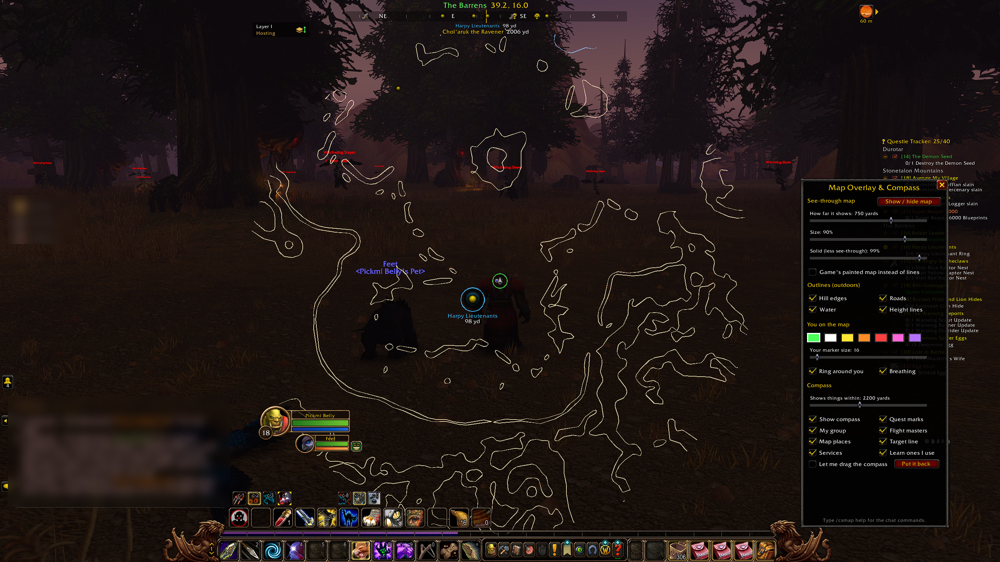
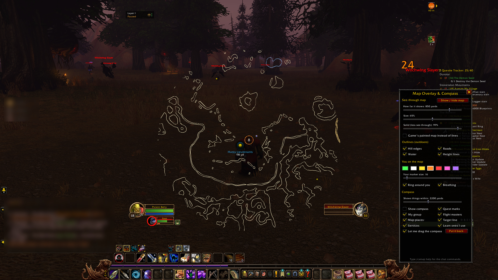
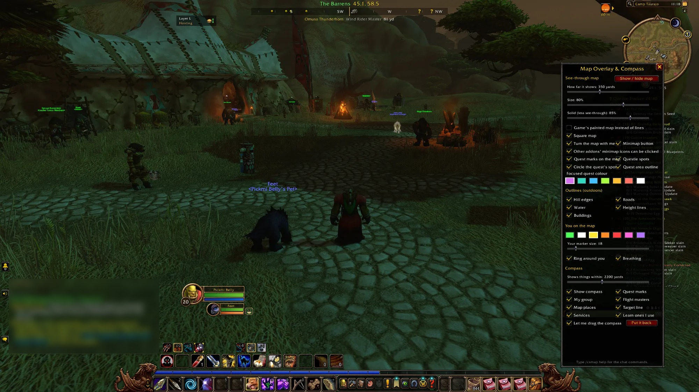
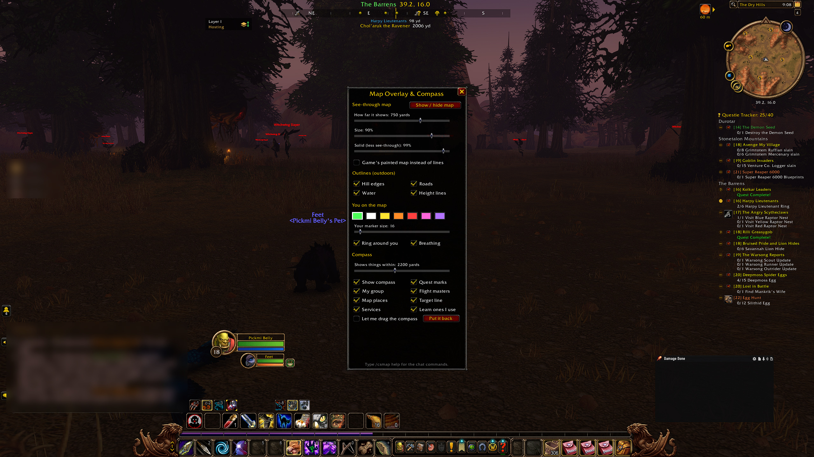

# Map Overlay & Compass for WoW Forever

A see-through, click-through map over the middle of your screen and a compass bar, by **ClanStop**. Outlines of hills,
roads and water for all of Eastern Kingdoms and Kalimdor, Zephra's Isle, Darkspear Islands, Forever's new instances, the
battlegrounds and the outdoor parts of dungeons and raids; quests (your focused quest in blue), your group, flight
masters, banks, inns and trainers on the compass and the map; your target's role and distance. No other addons needed.

## Download

**[Download the latest version](../../releases/latest)** (the `.zip` under Assets).

It's also coming to CurseForge as "Map Overlay & Compass"; once it's there, CurseForge keeps it up to date for you.

## Screenshots

**Outdoors: hills, roads and water as clean lines**, laid over the game. Clicks go straight through to the world.

**In a fight** the map stays out of your way, and you can still click your target through it.

**Zoomed in to 300 yards.** Your focused quest is circled in blue, with its name and distance.

**The compass bar** with your zone and coordinates, quest marks and what's straight ahead. Drag it anywhere, here
over the middle of the map.

**Settings window** (`/csmap`): how far, how big, how see-through, which outlines and marks, your own colour.

## Install

1. Close World of Warcraft.
2. Open the zip. It has four folders: `ClanStopMap`, `ClanStopMap_EasternKingdoms`, `ClanStopMap_Kalimdor` and
   `ClanStopMap_OtherMaps`. (Had 0.7.0? You can delete its old `ClanStopMap_ZephrasIsle` folder.)
3. Put all four in your Forever AddOns folder, usually
   `C:\Program Files (x86)\World of Warcraft\_forever_\Interface\AddOns\`
   (replace them if they're already there).
4. Start the game. On the character screen, open **AddOns** and make sure all four are ticked.

## Use

- **The button on your minimap:** left-click for the settings, right-click to show or hide the map. Drag it
  to move it around the minimap.
- `/csmap` opens the settings window.
- `/csmap hud` shows or hides the map, or set a key: Options > Key Bindings > AddOns > ClanStop Map Overlay & Compass.
- `/csmap help` lists every command.

## Help

Ask on ClanStop's Discord. The link is at the bottom of every page on clanstop.com.

---

(c) ClanStop. All rights reserved. This page only hosts the downloads; the addon is not open source.
