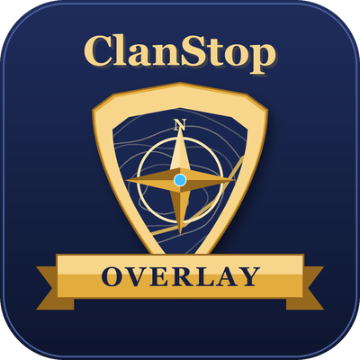
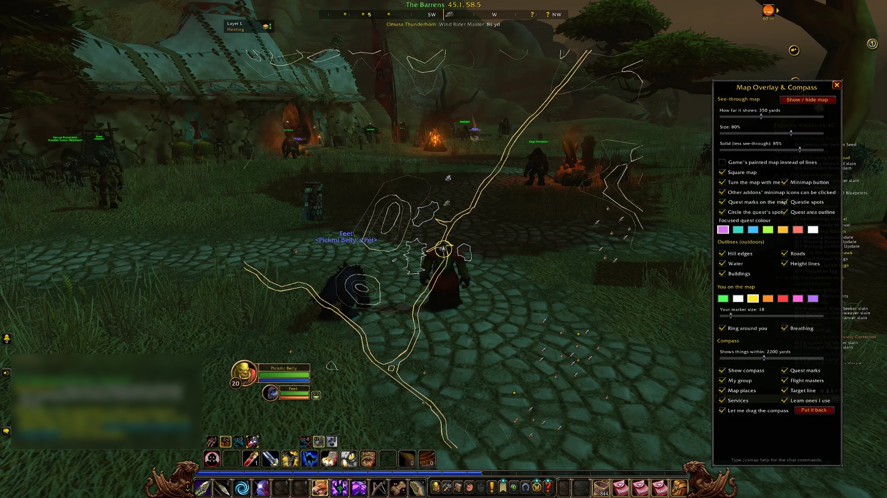
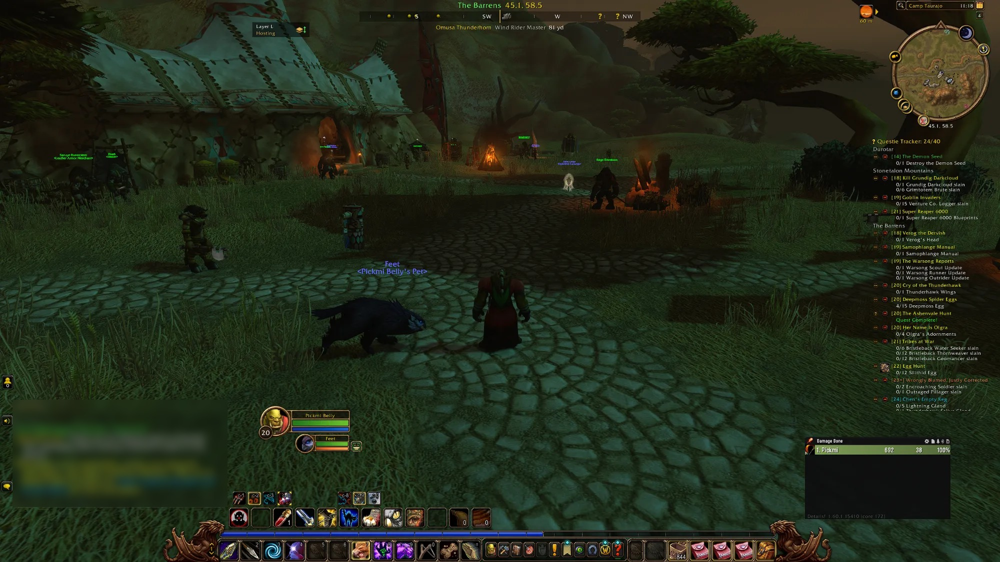

# Map Overlay & Compass for WoW Forever

A see-through, click-through map over the middle of your screen and a compass bar, by **ClanStop**. Outlines of hills,
roads, water and buildings for all of Eastern Kingdoms and Kalimdor, Zephra's Isle, Darkspear Islands, Forever's new instances, the
battlegrounds and the outdoor parts of dungeons and raids; quests (your focused quest in a colour you pick), your group, flight
masters, banks, inns and trainers on the compass and the map; your target's role and distance. No other addons needed.

## Download

**[Download the latest version](../../releases/latest)** (the `.zip` under Assets).

It's also coming to CurseForge as "Map Overlay & Compass"; once it's there, CurseForge keeps it up to date for you.

## Screenshots

**Roads, hills and buildings as clean lines**, laid over the game. Zoomed in to 350 yards in Camp Taurajo you see the
roads and the outline of every building around you. Clicks go straight through to the world.

**Your focused quest's whole area** outlined in your colour, with Questie's own icons for the mobs to kill.

**Focus a quest from the map:** double-click or hold its mark.

**Settings window** (`/csmap`): how far, how big, how see-through, which outlines and marks, your own colour.

**Without the addon**, for comparison: just the game's small minimap in the corner.

## Install

1. Close World of Warcraft.
2. Open the zip. It has four folders: `ClanStopMap`, `ClanStopMap_EasternKingdoms`, `ClanStopMap_Kalimdor` and
   `ClanStopMap_OtherMaps`. (Had 0.7.0? You can delete its old `ClanStopMap_ZephrasIsle` folder.)
3. Put all four in your Forever AddOns folder, usually
   `C:\Program Files (x86)\World of Warcraft\_forever_\Interface\AddOns\`
   (replace them if they're already there).
4. Start the game. On the character screen, open **AddOns** and make sure all four are ticked.

## Use

- **The button on your minimap:** left-click for the settings, right-click to show or hide the map. Drag it
  to move it around the minimap.
- `/csmap` opens the settings window.
- Mouse over any mark on the map or the compass to see what it is. Tick "Square map" in the settings for a square map.
- `/csmap hud` shows or hides the map, or set a key: Options > Key Bindings > AddOns > ClanStop Map Overlay & Compass.
- `/csmap help` lists every command.

## Help

Ask on ClanStop's Discord. The link is at the bottom of every page on clanstop.com.

---

(c) ClanStop. All rights reserved. This page only hosts the downloads; the addon is not open source.
